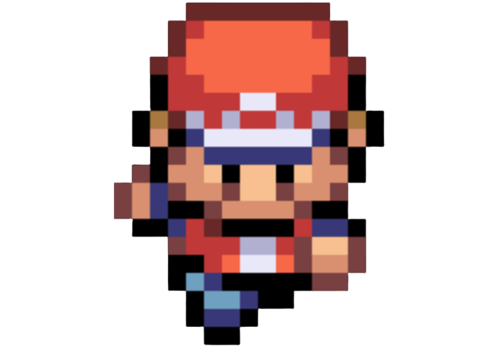
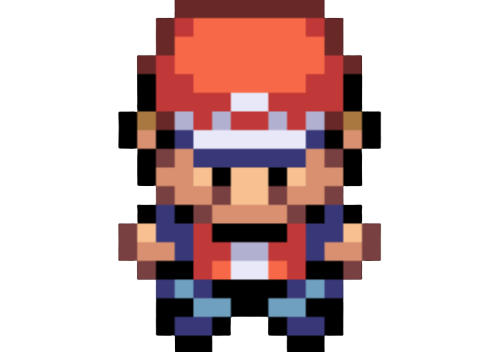
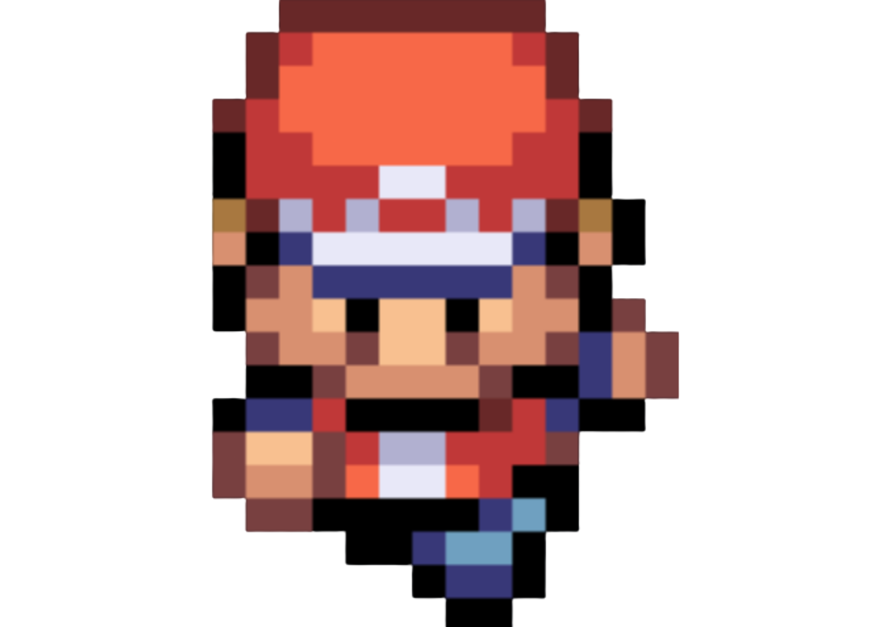

The code for the game is here
Please use the code tab instead

HTML

  
  
  
  
  
  
  

CSS

img {
  display: inline-block;
  margin: 0 auto;
  
}

JavaScript

document.getElementById("player-1down").style.display="none";
document.getElementById("player-2down").style.display="block";
document.getElementById("player-3down").style.display="none";
let isWalking = 1

window.addEventListener('keydown', function(){
// starting checking code
if (isWalking === 1) {
document.getElementById("player-2down").style.display="none";
isWalking = 0
document.getElementById("player-1down").style.display="block";
setTimeout(function() {
document.getElementById("player-1down").style.display="none";
document.getElementById("player-3down").style.display="block";
setTimeout(function() {
document.getElementById("player-3down").style.display="none";
isWalking = 1;
}, 200);
}, 200);
}
});
window.addEventListener('keyup', function(){
document.getElementById("player-1down").style.display="none";
document.getElementById("player-2down").style.display="block";
document.getElementById("player-3down").style.display="none";
});
